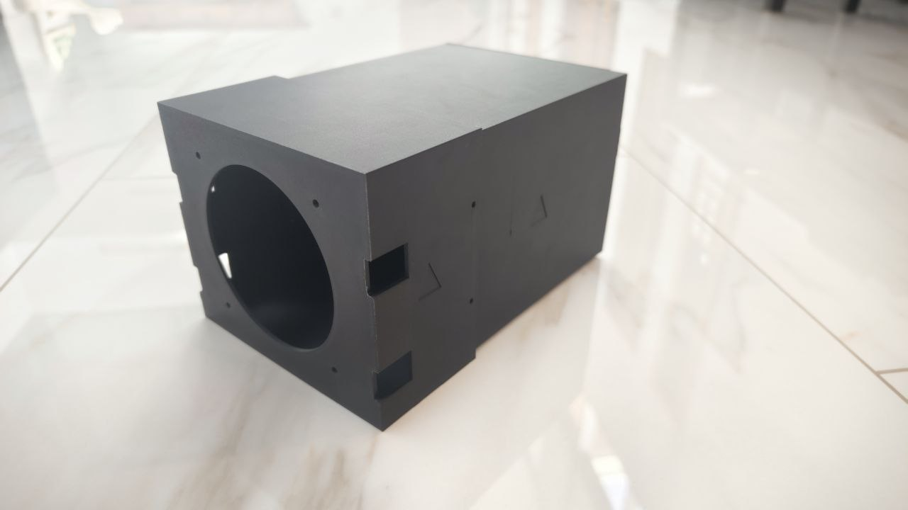

# DGX Spark Duo print files

Original design by Stepan Kandrushin: an ABS body and cap for two DGX Sparks with
120 mm external fans. These are the exact requested design files, copied without
rescaling. The case photos show the printed parts; the render shows the intended
computer arrangement.

| File | Purpose |
| --- | --- |
| [DGX_Spark_Duo_body.stl](DGX_Spark_Duo_body.stl) | Main enclosure and support rails |
| [DGX_Spark_Duo_cap.stl](DGX_Spark_Duo_cap.stl) | Opposite end cap with optional fan mount |
| [DGX_Spark_Duo_preview.png](DGX_Spark_Duo_preview.png) | Design render with two computers |
| [DGX_Spark_Plan.png](DGX_Spark_Plan.png) | Section drawing, dimensions in mm |

Photos in this same directory: [assembled exterior](DGX_Spark_Duo_photo_01.jpg),
[body and cap](DGX_Spark_Duo_photo_02.jpg), [inside both parts](DGX_Spark_Duo_photo_03.jpg),
[opposite exterior](DGX_Spark_Duo_photo_04.jpg), [open body and rails](DGX_Spark_Duo_photo_05.jpg).

## Print settings

The saved owner slicer projects identify a Bambu Lab X1 Carbon with a 0.4 mm
nozzle and Generic ABS. Their recorded settings are:

| Setting | Body | Cap |
| --- | --- | --- |
| Layer height | 0.20 mm | 0.20 mm |
| Wall loops | 2 | 2 |
| Infill | 15%, grid | 15%, grid |
| Supports enabled | No | No |
| Brim | Outer, 5 mm | Outer, 10 mm |
| Nozzle setpoint | 270 °C | 270 °C |
| Textured plate profile setpoint | 90 °C | 105 °C |

These are saved profile values, not a universal ABS recipe or a log proving the
temperatures of a completed print. Use the profile appropriate to your printer,
filament and plate. Printer-specific G-code is not distributed here; slice the
STLs yourself. The body is taller than the cap in their saved print orientations.

STLs do not encode a unit. Import as millimetres and verify these mesh bounding
dimensions before slicing (X × Y × Z in the saved orientation):

- Body: 172.0 × 152.5 × 193.8 mm, 3,730 triangles.
- Cap: 178.5 × 155.5 × 86.2 mm, 3,474 triangles.

These dimensions are for each part, not the assembled case. The section drawing
shows 12 mm top/bottom clearance and an 18 mm open gap between Sparks. Check the
printed fit and rail support before placing either computer in it.

See the [assembly, airflow, measurement and undo guide](../docs/printed-enclosure.md).
The original designs, drawings and case photos use the repository's [MIT license](../LICENSE).
