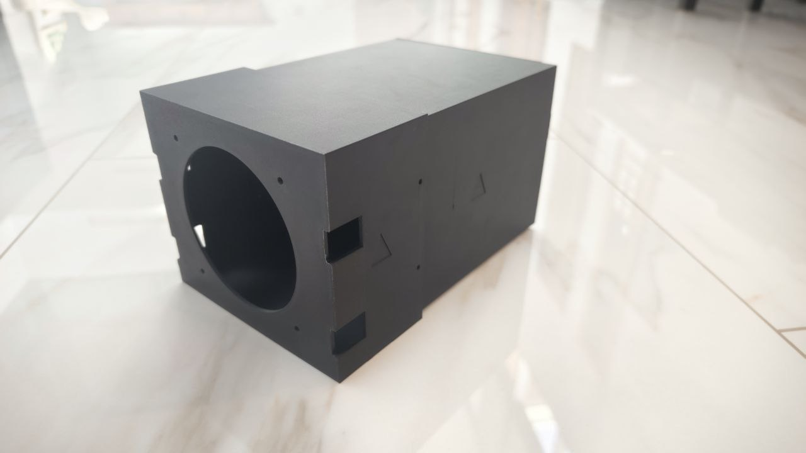
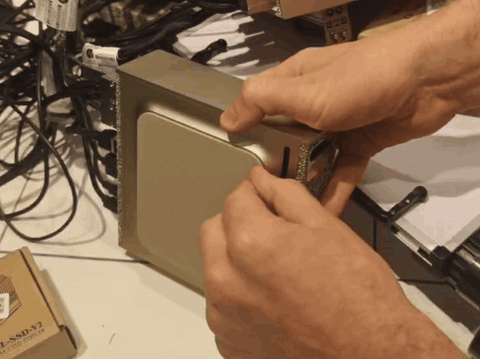

# DGX Spark Cooling

We run NVIDIA DGX Sparks for LLM inference, and under long load they run warm.
These are the four things we did to cool them:

1. Took off the decorative plastic cover on the bottom.
2. Put two Sparks into an ABS enclosure I designed and printed, with 120 mm
   fans moving air through it.
3. Capped the GPU clock at 2,200 MHz.
4. Raised the minimum speed of the Spark's own fans to 9,000 RPM.

This repository has the print files, a guide for each step, our measurements,
and how to undo every change.



**Print files:** [body](3d-print/DGX_Spark_Duo_body.stl) ·
[cap](3d-print/DGX_Spark_Duo_cap.stl) ·
[preview](3d-print/DGX_Spark_Duo_preview.png) ·
[section drawing](3d-print/DGX_Spark_Plan.png) ·
[photos and print notes](3d-print/README.md)

## The methods we use

### 1. Remove the bottom cover

The underside of the Spark is a decorative plastic panel. Behind it are the NVMe
drive and the Wi-Fi antennas. With the panel off, air can move across the drive
area. The panel comes off by hand and goes back on the same way. Afterwards the
Spark has to stand on its edges with space underneath. Don't set it flat on a
table.



We haven't measured this change on its own. Guide: [bottom cover](docs/bottom-cover.md).

### 2. Put two Sparks in the ABS enclosure

The enclosure holds two Sparks one above the other, with an 18 mm gap between
them and 12 mm of space above and below. They rest on narrow rails along their
edges, so their open undersides stay in the airflow. A 120 mm fan at one end
moves air through the gaps past both machines, and the cap at the other end can
hold a second fan. The fans need their own 12 V supply.

We haven't measured this one on its own either. Guide: [printed enclosure](docs/printed-enclosure.md).

### 3. Cap the GPU clock at 2,200 MHz

The Spark's GPU can boost as high as 3,003 MHz. In our test, running it above
2,200 MHz cost a lot of power and gave very little speed. One `nvidia-smi`
command, plus a small systemd unit to reapply it at boot, stops the GPU at
2,200 MHz. Nothing else changes, and one command undoes it.

In our test, GPU peak temperatures fell from 74–77 °C to 67–69 °C, and busy GPU
power from 44.8–49.1 W to 28.5–31.1 W. A single request generated text only
1–2% slower. Sixteen requests at once lost 7.6% of their combined throughput.
Guide: [GPU clock cap](docs/gpu-clock-cap.md).

### 4. Raise the internal fan minimum to 9,000 RPM

Under load, the Spark's automatic fan control kept its two internal fans at
about 3,600 and 5,400 RPM in our test. We set a floor of 9,000 RPM. The fans
don't go below that, and the firmware can still spin them faster when it
wants to.

With the clock cap already on, the average GPU temperature fell from 60.0 to
52.7 °C and the NVMe drive from 48.6 to 42.9 °C. The cost is fan noise and
setup work. The fan driver works only with an older EC firmware, 3.5.8. That
firmware has a bug that can stop the fans at idle, so it also needs a
workaround. Guide: [fan floor](docs/fan-floor.md).

### How to read these numbers

The clock-cap and fan-floor numbers come from two separate experiments, and the
fan test ran with the cap already on. **Don't add them together** into one
stock-to-final figure. All the numbers come from four Sparks. Six now run the
same clock and fan settings, but we haven't measured the other two. None of the
four was throttling or shutting down before the changes. We wanted them cooler,
not to fix a failure. Full tables, method and what didn't work:
[results](docs/results.md).

## Trying it on your own Spark

1. Measure before changing anything, so you have something to compare with.
2. Do the physical changes one at a time and measure after each.
3. Try the clock cap. It needs no firmware change and is easy to undo. Check
   temperatures, tokens per second and prefill time before you keep it.
4. Do the fan floor last, and only after reading its whole guide. It requires
   downgrading the EC firmware. It doesn't work on the current EC, 3.13.7.
5. After each change, check again after a reboot, under long load and at idle.
   Look at both fan speeds and the EC clock, not only the GPU temperature.

To take a baseline, run these on the Spark from this checkout:

```sh
mkdir -p measurements
python3 scripts/thermal-sample.py --duration 60 --interval 2 > measurements/baseline.csv
python3 scripts/spark-fan status
```

Both commands only read and change nothing. `thermal-sample.py` writes one CSV
row per sensor at each sample, covering every thermal zone, the GPU and each
NVMe drive. `spark-fan status` prints the EC firmware version, whether the EC
link is healthy, both fan speeds and the temperatures. It exits non-zero if
something is wrong. If the fan driver isn't loaded, it can't tell you whether a
floor is set. Keep longer runs in `measurements/`, which git ignores.

## What's in the repository

- Four guides in [docs/](docs/), one per method. The bottom-cover guide also
  covers a small external cooler we tried for a while.
- The enclosure's two STL files, a render, a dimensioned drawing and five photos
  in [3d-print/](3d-print/README.md).
- `scripts/spark-fan`, a checked wrapper around the fan driver; systemd units for
  the clock cap and the fan floor; `scripts/thermal-sample.py`, a read-only
  sampler; and offline tests.
- [Measurement tables](results/) copied from our original experiment records.
- [Sources and credits](docs/sources.md).

`scripts/spark-fan` is the public version of the wrapper we run on our machines.
Ours only runs on machines from a private list. This one asks you to register
your Spark's hostname and serial once instead. The firmware, EC-health and
readback checks are the same. **The public version passes its offline tests but
hasn't been run on a Spark yet.** The measurements come from the original
version on real hardware. There's no automatic installer or firmware flasher.
Every step is manual.

## Compatibility

We ran the fan procedure on NVIDIA DGX Spark with EC 3.5.8, SoC 2.158.15,
kernel 7.0.0-1025-nvidia and the unmodified, signed dgx_ec_fan_control 0.1.4
module, commit `d121e06f0b62837632656ba95dc0d6445951142c`, with Secure Boot on.
After a kernel update the module has to be rebuilt and signed again. Other
firmware combinations and partner GB10 machines are untested.

## Development and license

```sh
python3 -m unittest discover -s tests -v
```

The code, documentation, STL designs, drawings and photos here are under the [MIT license](LICENSE).
The [upstream fan driver](https://github.com/christopherowen/dgx-spark-fan-control)
is installed separately under its own license and isn't included here. The
[source index](docs/sources.md#fan-control) gives the pinned version and credits.
