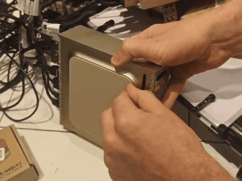

# Remove the decorative bottom cover

The bottom of the Spark is a decorative plastic panel. Behind it are the NVMe
drive and the Wi-Fi antennas. Taking the panel off lets air move across that
area, especially around the drive. That matters most once the Spark sits in the
[ABS enclosure](printed-enclosure.md), where a fan moves air through the gaps
around it.



That's the whole job: the panel comes off with your fingers in a few seconds, no
tools. Only the outer panel comes off. The metal chassis, the drive, the antennas
and every heatsink stay where they are. The magnets you'll see under it don't hold
the panel. They're there to catch the screws when you unscrew them, so they don't
roll away, but nothing gets unscrewed here.

We haven't measured the effect of the panel alone.

## Take it off

1. Measure first: run your usual long workload and record temperatures,
   including the NVMe drive (see [measuring](#measure-the-difference) below).
2. Tip the Spark onto its side and pull the panel off by hand, as in the clip
   above. Keep it for later. If it resists, look at how it's held before
   pulling harder. Don't pry near the electronics.
3. Leave the drive, antennas and chassis alone. Keep tools and loose metal away
   from the exposed underside.
4. From now on, stand the Spark on its edges with air space below it, for example
   on the enclosure's rails. Don't put the open underside flat on a table or a
   solid shelf. Taking the panel off doesn't move any air by itself. It only
   helps if air can actually reach the underside.
5. Run the same workload with the same clock and fan settings, and record
   temperatures again. Watch the drive as well as the GPU.

## The small external cooler

I also tried a small external cooler under the Spark for a while. It helped a
little, but it was only a stopgap. Once the enclosure moves air past the
machines, you don't need it. I didn't measure it or work out a proper way to
mount it, so there's no guide for it.

## Measure the difference

Keep everything else the same between the two runs: workload, room temperature,
where the machine stands, clock cap and fan settings. Write those down. Start
the sampler, run your workload alongside it, and compare the settled part of
each run. If the drive temperature is still climbing at the end, run longer.

```sh
mkdir -p measurements
python3 scripts/thermal-sample.py --duration 900 --interval 2 > measurements/cover-on.csv
# Remove the panel, then repeat the same workload.
python3 scripts/thermal-sample.py --duration 900 --interval 2 > measurements/cover-off.csv
```

The sampler only records temperatures. It doesn't create load, so run your
workload at the same time. Compare a loaded run with another loaded run, never
with an idle one. Keep these results apart from our
[clock and fan measurements](results.md), which test different things.

## Put it back

Remove any extra cooler, press the panel back on without trapping cables or
pressing on the antennas, and put the Spark back where it was.
Run the same load check again.
