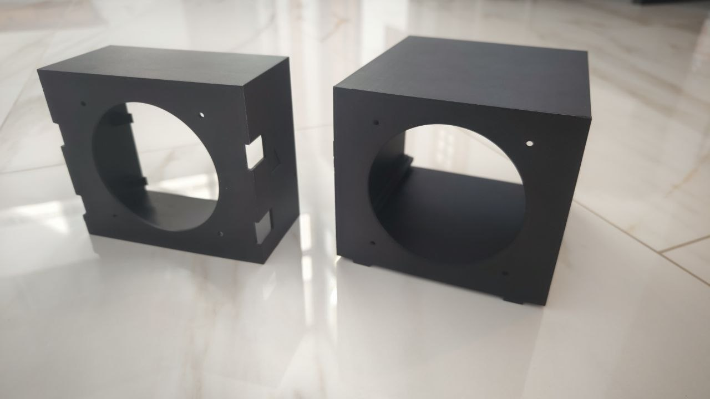
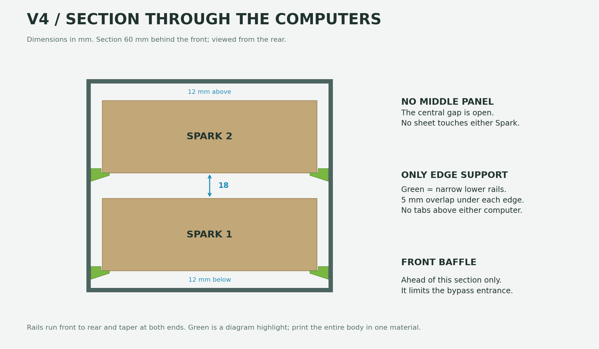

# ABS enclosure for two DGX Sparks

I designed this enclosure for two Sparks, with a fan that pushes air past both
of them. It prints in two ABS parts. The body holds the machines and a 120 mm
fan, the cap closes the other end and can take a second fan. Each Spark sits on
rails along its edges, so the air goes above, between and below the machines,
and if you've [removed the bottom covers](bottom-cover.md), along the undersides
too.

We ran two Sparks in it, with both fans, on NVIDIA's stock automatic fan curve,
against two Sparks outside it that hold the [9,000 RPM fan floor](fan-floor.md).
Under the same long inference load the two in the enclosure stayed within a few
degrees of the floored pair, with cooler NVMe drives and no throttling. But I
have to say right away - this test changed two things at once, the enclosure
and the fan control, so it isn't a before/after number for the enclosure alone.
Details are in [results](results.md#printed-enclosure-against-the-fan-floor).



## What you need

- [Body STL](../3d-print/DGX_Spark_Duo_body.stl), printed once.
- [Cap STL](../3d-print/DGX_Spark_Duo_cap.stl), printed once, if you want the
  closed version.
- One 120 mm fan, and a second one if you want. I use ARCTIC P12 Pro PST.
- Screws to mount the fan, and a 12 V supply for it. From USB the fan doesn't
  run, and don't count on a fan header inside the Spark. I connect mine directly
  to the 12 V supply with a self-made connector and leave the PWM wire
  unconnected, so it always runs at full speed. If you want it slower and
  quieter, add a fan controller.

The [design preview](../3d-print/DGX_Spark_Duo_preview.png), the
[section drawing](../3d-print/DGX_Spark_Plan.png), the photos and the
[print settings](../3d-print/README.md#print-settings) - all of it is in
[3d-print/](../3d-print/README.md).

## How the air flows



On the drawing there is 12 mm of space above the upper Spark, an open 18 mm gap
between the two, and 12 mm below the lower one. Narrow rails hold each machine
by its lower edges, with 5 mm of overlap. Under the upper Spark there is no
shelf on purpose, so that air reaches its whole underside. The baffle at the
front is there so that air goes past the machines and not around them. The
openings at the ends are for the fans and cables.

These are the dimensions in the design, and a print can come out slightly
different, so check the fit before you put the computers in. The rails are
green on the drawing only to highlight them, the whole body is one material.

## Assemble

1. Print the body and, if you want, the cap. Check for cracks, warped rails and
   rough edges, remove the brim, and check that the cap fits the empty body.
2. First try the fan in place. The screws should be long enough to hold it, but
   short enough not to reach a computer or crack the wall. Keep its cable away
   from the blades.
3. If you're taking off the bottom covers, do it now, and keep the panels.
4. Slide the machines onto the rails, don't force them. Check that the gap is
   open, the undersides have clearance and you can reach the ports. Run the
   cables through the openings so that the cap doesn't pinch them.
5. Point the fan by the arrow on its frame so that it blows through the
   enclosure. With a second fan, both have to point the same way, otherwise
   they fight each other. Don't block the Sparks' own vents.
6. Fit the cap if you use it. Connect the fans to their 12 V supply and check
   that the air moves and nothing touches the blades.
7. Check that the sensors of both machines read normally, and run the same
   long workload that you used for your baseline. Watch both machines and both
   NVMe drives, not only the GPU.

ARCTIC P12 Pro PST is a 12 V DC, 0.33 A fan with a four-pin PWM connector.
ARCTIC rates its static pressure at 6.9 mmH₂O - this is the maker's figure, we
didn't measure it in the enclosure. See the
[ARCTIC P12 Pro PST specification sheet](https://www.arctic.de/media/2c/de/c6/1750758983/Spec_Sheet_P12_Pro_PST_EN.pdf)
and the [source notes](sources.md#external-enclosure-fan).

## Measure the difference

The workload, room, clock cap and internal fan settings stay the same, and you
compare three setups - how the Sparks stood before, the enclosure with one fan,
and if you want, the enclosure with two fans. Write down the external fan speed
and the settled temperature of each NVMe drive.

```sh
mkdir -p measurements
python3 scripts/thermal-sample.py --duration 900 --interval 2 > measurements/enclosure-one-fan.csv
# Repeat the same workload and sampling for the setup you're comparing against.
```

If at the end the temperatures are still changing, run longer. Listen to the
noise also, and check that both machines behave normally at idle. Our
[enclosure test](results.md#printed-enclosure-against-the-fan-floor) changed the
fan control together with the enclosure, so it doesn't replace this comparison.
And the [fan-floor sweep](results.md#fan-floor) is about the Spark's internal
fans, not about this enclosure.

## Take it apart

Take off the cap and lift the machines out, without pulling on cables or
pressing on the antennas. If you want, refit the bottom panels, and put the
Sparks back where they were. Run the load check again. The enclosure doesn't
change any software settings.
